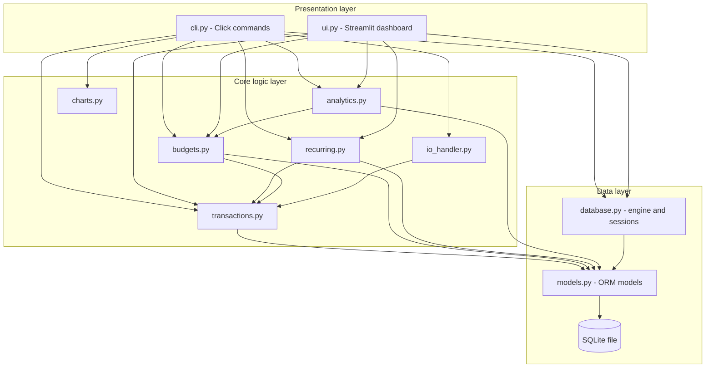
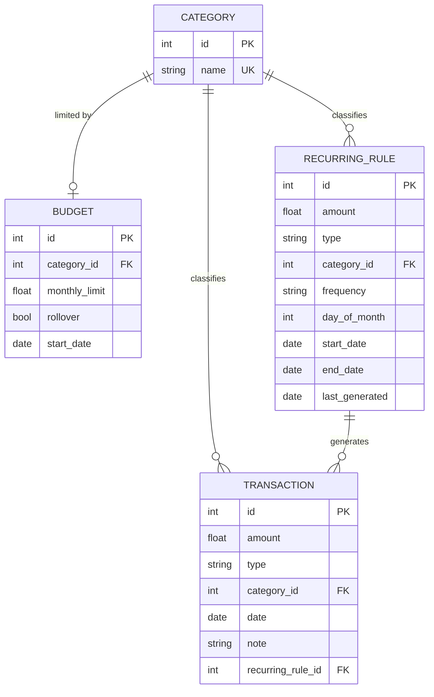

# Ledgerly — Architecture

## 1. Style: Layered Architecture
Dependencies only point **downwards**. The presentation layer never touches the database directly,
and the data layer knows nothing about business rules.

## 2. Module Overview
| Layer | Module | Responsibility |
|---|---|---|
| Presentation | `cli.py` | Parse commands, call logic, format output |
| Presentation | `ui.py` | Streamlit dashboard over the same logic |
| Logic | `transactions.py` | Validation + CRUD of transactions and categories |
| Logic | `budgets.py` | Budgets, spend, rollover, status and alerts |
| Logic | `recurring.py` | Rules, occurrence calculation, generation |
| Logic | `analytics.py` | Summaries, breakdowns, month-over-month, forecast |
| Logic | `io_handler.py` | CSV import/export |
| Logic | `charts.py` | PNG chart rendering |
| Data | `models.py` | ORM entities |
| Data | `database.py` | Engine, schema creation, transactional session |
| Shared | `errors.py` | `ValidationError`, `NotFoundError` |

## 3. Entity-Relationship Diagram

## 4. Key Design Decisions
| Decision | Rationale |
|---|---|
| SQLite + SQLAlchemy ORM | Zero-install local database; ORM keeps logic independent of SQL dialect |
| Functions take a `session` argument | Dependency injection: tests pass an in-memory DB, CLI/UI pass a real one |
| Domain exceptions | Presentation converts them into friendly messages; logic never prints |
| `last_generated` on recurring rules | Makes generation idempotent and incremental |
| Month-end clamping via `calendar.monthrange` | Correct handling of 28/29/30/31-day months and leap years |
| Rollover computed on demand | No stored carry value to go stale when transactions are edited or deleted |
| Amounts rounded to 2 decimals | Avoids floating-point noise in totals |

## 5. SDLC Model: Incremental
| Increment | Deliverable | Status |
|---|---|---|
| 1 | Requirements, ER design, schema, transaction CRUD + CLI | Done |
| 2 | Budget engine (limits, status, rollover, alerts) | Done |
| 3 | Recurring transaction engine | Done |
| 4 | Analytics + forecast | Done |
| 5 | CSV import/export + charts | Done |
| 6 | Streamlit dashboard, test hardening, documentation | Done |

Each increment ended with a working, tested build; tests were written alongside the code.
